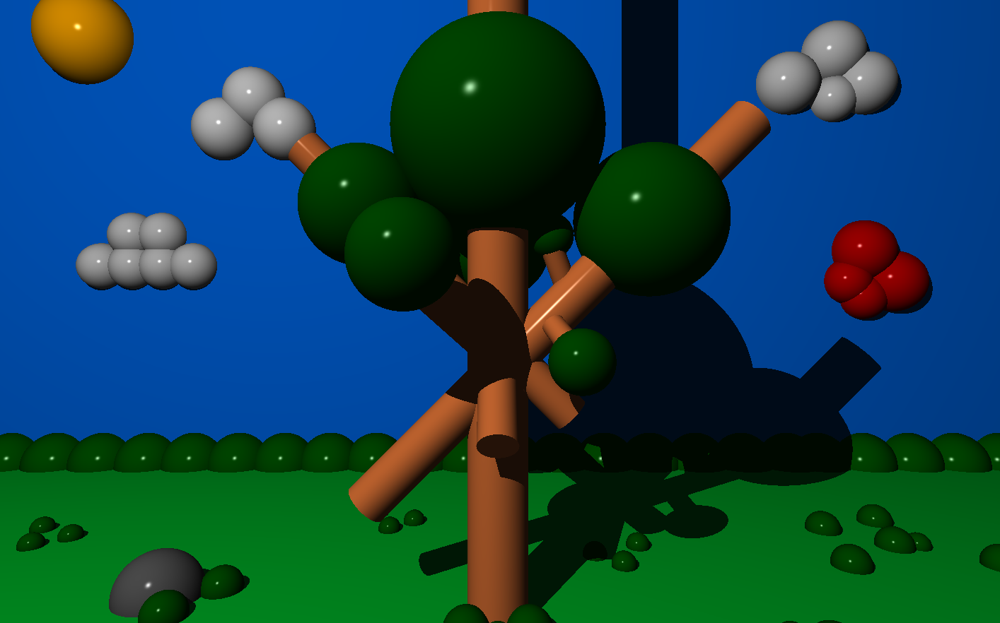

*This project has been created as part of the 42 curriculum by aabdella, pecastro.*
# Description
**miniRT** is a minimal ray tracer written in C as part of the 42 curriculum. The goal of the project is to generate computer-generated images using the ray tracing technique, by simulating how rays of light interact with objects in a 3D scene.

The program takes as input a scene description file (.rt) and renders the corresponding image in a window using the MiniLibX library. Each scene is composed of simple geometric objects such as planes, spheres, and cylinders, along with a camera and lighting system. The rendering process computes ray-object intersections, surface normals, and lighting effects to produce a realistic image from a given point of view.

miniRT implements the fundamental concepts of ray tracing, including object transformations (translation and rotation), handling of intersections (including object interiors), and basic lighting models such as ambient and diffuse lighting with shadows. The project focuses on building a solid understanding of vector mathematics, geometry, and light behavior, while respecting strict coding standards and memory management constraints.

This project serves as an introduction to rendering techniques and demonstrates how mathematical and physical principles can be applied to generate visually coherent 3D scenes.

# Instructions
### Compilation
The project is compiled using the provided Makefile. The rules are:

make → compiles the project  
make clean → removes object files  
make fclean → removes object files and the executable  \
make re → recompiles everything from scratch

### Installation
The MiniLibX library is required for graphical rendering. Before compiling, install it (name it minilibx-linux), and place it in the project's root folder.

### Execution
The program must be executed with a scene file in .rt format as argument:

./miniRT scene.rt

The .rt file describes the scene to render (objects, lights, camera, etc.). The program will open a window and display the rendered image.

# Resources
### References

* “Ray Tracing Challenge” by Jamis Buck – served as the main reference for implementing the ray tracing algorithms and scene structure.

* MiniLibX documentation – used to manage windows, images, and events.

* C standard library documentation (man pages) – for functions like malloc, free, printf, exit, and math functions (math.h).

* Tutorials and articles on vector mathematics, ray-object intersections, and lighting models were consulted to understand the underlying math and physics of ray tracing.

### AI Assistance

AI tools were used to:

* Generate examples of README sections and documentation structure.

* Explain and clarify C coding patterns, such as memory management, loops, and modular function design.

* Help with concise explanations of ray tracing concepts, program workflow, and Norminette-compliant code style.

* No AI was used to write the core ray tracing algorithms or generate the .rt scene files; all implementation logic and code were developed independently.
